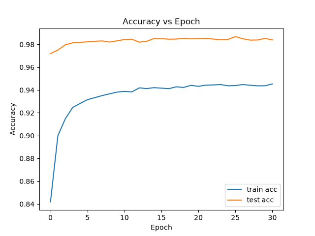
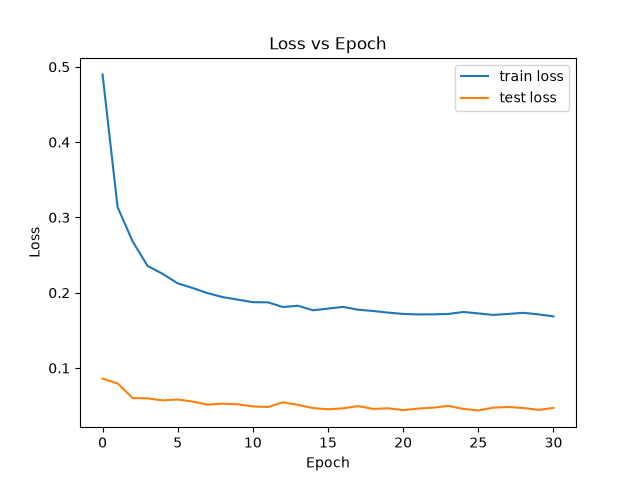
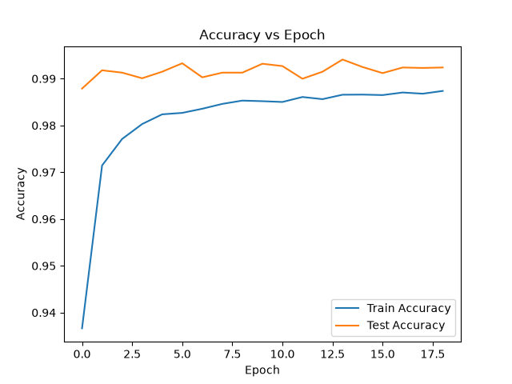
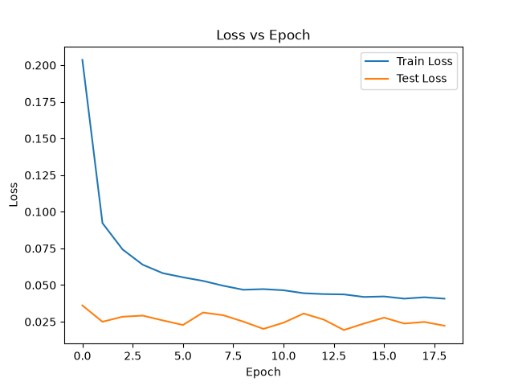

# Handwritten Digit Recognition with PyTorch: MLP vs. CNN

Two neural networks trained from scratch on MNIST, plus a desktop drawing app that classifies the digit you sketch while you draw it.

<p align="center">
  
</p>

| Model | Test accuracy | Errors (of 10,000) | Parameters | Epochs (early stopped) |
| --- | --- | --- | --- | --- |
| MLP | **98.69%** | 131 | 537K | 31 |
| CNN | **99.41%** | 59 | 3.42M | 19 |

Accuracy is measured on the full 10,000-image MNIST test set using the best saved checkpoint for each model ([`models/model_best_20260919_133133.pth`](models/model_best_20260919_133133.pth) and [`models_cnn/model_best_20260919_161139.pth`](models_cnn/model_best_20260919_161139.pth)).

## Highlights

- **Two architectures, one pipeline.** A fully connected MLP and a convolutional network share the same data loading, training loop and evaluation code, so the comparison between them is like-for-like.
- **Hand-written training loop.** Shuffled mini-batching, train/eval mode switching, per-epoch loss and accuracy, best-checkpoint saving and early stopping are all implemented directly in PyTorch, without a DataLoader or training framework.
- **Data augmentation.** About 30% of training images get an extra copy that is randomly rotated, shifted and overlaid with noise, which makes the models more robust to messy, hand-drawn input.
- **Interactive demo.** A Tkinter app lets you draw on a 280×280 canvas, downsamples the drawing to 28×28 and shows live class probabilities for all ten digits.
- **Hardware-aware.** Training and inference pick CUDA, Apple Silicon (MPS) or CPU automatically.
- **End-to-end data pipeline.** A script converts the Hugging Face MNIST Parquet files into 70,000 labelled PNGs.

## Results

### MLP

<table>
  <tr>
    <td></td>
    <td></td>
  </tr>
</table>

### CNN

<table>
  <tr>
    <td></td>
    <td></td>
  </tr>
</table>

Training accuracy sits below test accuracy in both runs because it is measured on augmented images with dropout active, while evaluation uses clean images with dropout off.

The CNN halves the MLP's error count (59 vs. 131). Its convolution layers learn local stroke patterns that stay useful when a digit is shifted, while the MLP sees each pixel position as an independent input.

## Model architectures

**MLP** ([`mlp_model.py`](mlp_model.py))

```
Input: 784 (flattened 28×28 image)
→ Linear 512 → BatchNorm → ReLU → Dropout 0.3
→ Linear 256 → BatchNorm → ReLU → Dropout 0.3
→ Linear 10
```

**CNN** ([`cnn_model.py`](cnn_model.py))

```
Input: 1×28×28
→ Conv 3×3, 64 channels  → ReLU → MaxPool 2×2   (64×14×14)
→ Conv 3×3, 128 channels → ReLU → MaxPool 2×2   (128×7×7)
→ Flatten (6,272) → Linear 512 → BatchNorm → ReLU → Dropout 0.3
→ Linear 256 → BatchNorm → ReLU → Dropout 0.3
→ Linear 10
```

## Training setup

All hyperparameters live in [`constants.py`](constants.py).

| Setting | Value |
| --- | --- |
| Optimizer | Adam, learning rate 1e-3, weight decay 1e-4 |
| Loss | Cross-entropy |
| Batch size | 32 |
| Dropout | 0.3 |
| Epochs | Up to 100, stopped early after 5 epochs without a test-loss improvement (min. delta 1e-4) |
| Augmentation | ~30% of training images get an extra copy: rotation up to ±180°, shift up to ±5 px, multiplicative Gaussian noise |
| Input scaling | Pixel values divided by 255 |

## Getting started

### 1. Install dependencies

```bash
python3 -m venv .venv
source .venv/bin/activate
pip install torch numpy pillow pandas pyarrow matplotlib tqdm
```

The drawing app also needs Tkinter. It ships with the python.org installers; with Homebrew Python, run `brew install python-tk`.

### 2. Get the data

`dataset/` already contains the images as `dataset/train/*.png` (60,000) and `dataset/test/*.png` (10,000). Each filename holds the label: `00000_7.png` is image 0, digit 7.

<p align="center">
  
  
  
  
  
  
  
  
  
  
</p>

To rebuild it, download `train-00000-of-00001.parquet` and `test-00000-of-00001.parquet` from the [ylecun/mnist](https://huggingface.co/datasets/ylecun/mnist) dataset on Hugging Face into the project root, then run:

```bash
python extract_images.py
```

### 3. Train

```bash
python train.py       # MLP → checkpoints in models/, plots in plots/
python train_cnn.py   # CNN → checkpoints in models_cnn/, plots in plots_cnn/
```

Each run saves its best checkpoint as `model_best_<timestamp>.pth` and writes loss and accuracy plots for that run.

### 4. Try the drawing app

```bash
python drawing.py              # CNN (default)
python drawing.py --model mlp  # MLP
```

Draw a digit with the mouse, and the prediction and per-digit probabilities update as you draw. **Clear Canvas** resets the canvas, and **Export 28x28** saves the downsampled image as `drawing_28x28.png`. The app loads the newest checkpoint in `models_cnn/` or `models/`.

Here is the CNN (`model_best_20260919_161712.pth`) on one hand-drawn example of each digit:

<table>
  <tr>
    <td align="center"><br><sub>drawn 0 → <b>0</b> (85.3%)</sub></td>
    <td align="center"><br><sub>drawn 1 → <b>1</b> (96.3%)</sub></td>
    <td align="center"><br><sub>drawn 2 → <b>2</b> (82.4%)</sub></td>
    <td align="center"><br><sub>drawn 3 → <b>3</b> (100%)</sub></td>
    <td align="center"><br><sub>drawn 4 → <b>4</b> (96.5%)</sub></td>
  </tr>
  <tr>
    <td align="center"><br><sub>drawn 5 → <b>5</b> (100%)</sub></td>
    <td align="center"><br><sub>drawn 6 → <b>6</b> (99.8%)</sub></td>
    <td align="center"><br><sub>drawn 7 → <b>7</b> (86.3%)</sub></td>
    <td align="center"><br><sub>drawn 8 → <b>8</b> (76.0%)</sub></td>
    <td align="center"><br><sub>drawn 9 → <b>9</b> (99.8%)</sub></td>
  </tr>
</table>

All ten are classified correctly. The least confident calls are on loosely drawn shapes: the 8 (76%), the 2 (82%) and the 0 (85%, with 13% going to 9). Hand-drawn strokes are thicker and less centred than MNIST digits, so they are harder than the test set.

## Project structure

```
├── mlp_model.py        # MLP definition
├── cnn_model.py        # CNN definition
├── train.py            # MLP training loop
├── train_cnn.py        # CNN training loop
├── utils.py            # Data loading, augmentation, batching
├── constants.py        # Hyperparameters and device selection
├── plot.py             # Loss and accuracy charts
├── drawing.py          # Tkinter drawing and prediction app
├── extract_images.py   # Parquet → PNG dataset conversion
├── scratchpad.ipynb    # Exploration notebook
├── dataset/            # train/ and test/ PNG images
├── drawing_app_images/ # Screenshots of the drawing app
├── models/             # MLP checkpoints
├── models_cnn/         # CNN checkpoints
├── plots/              # MLP training curves
└── plots_cnn/          # CNN training curves
```

## Tech stack

Python 3.11 · PyTorch · NumPy · Pillow · pandas · Matplotlib · Tkinter · tqdm
